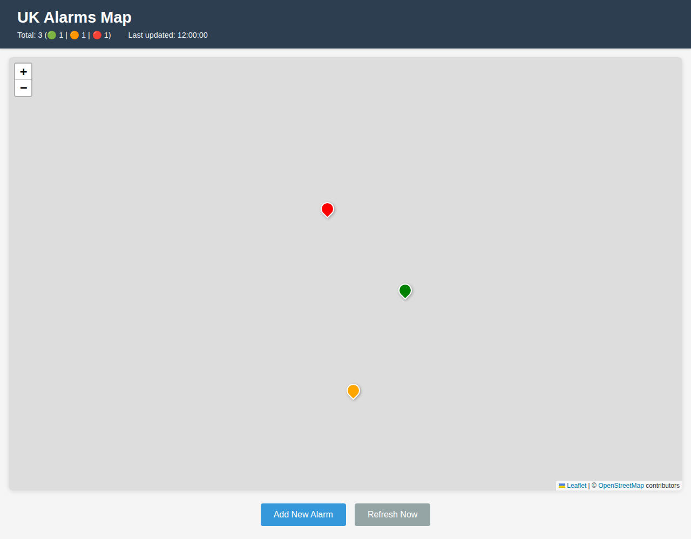
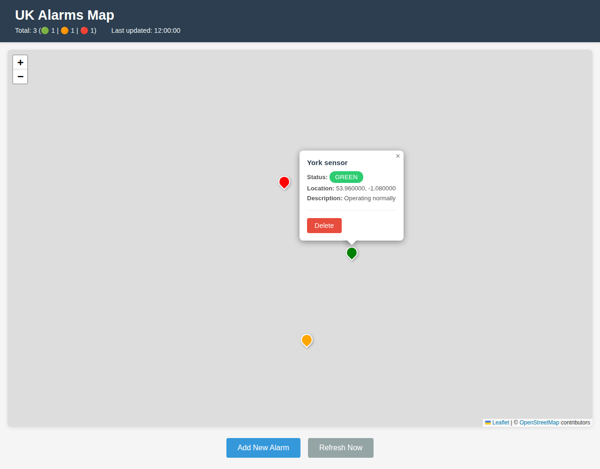
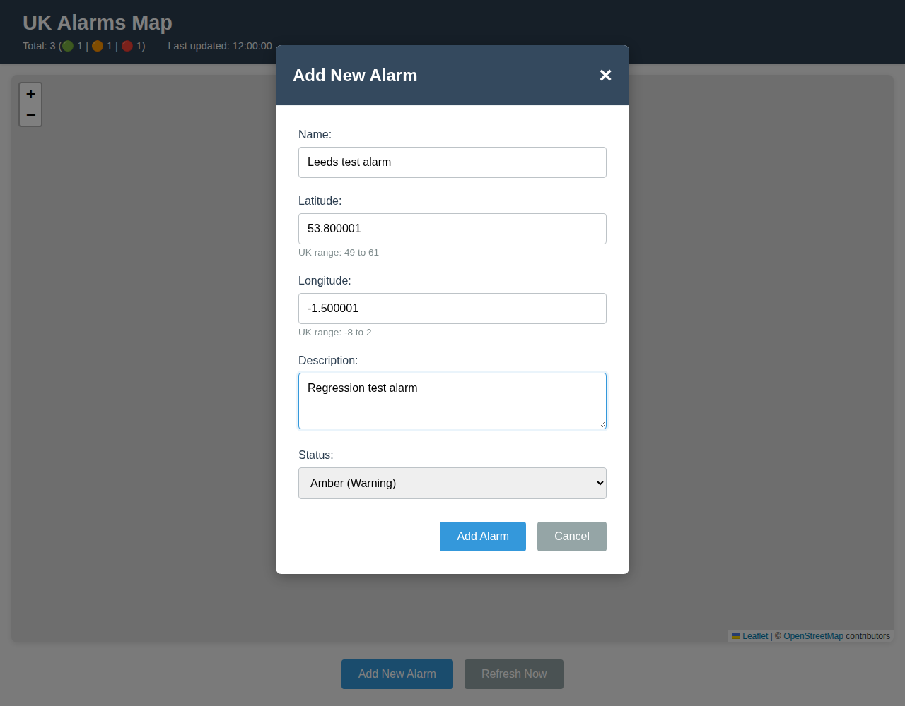
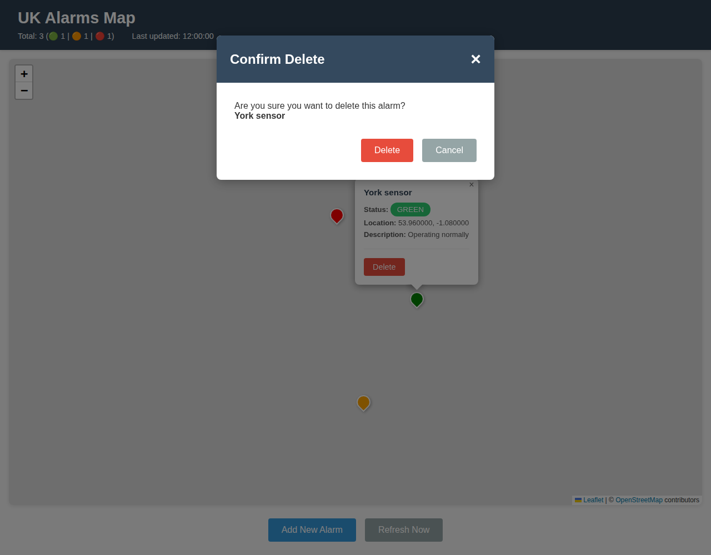
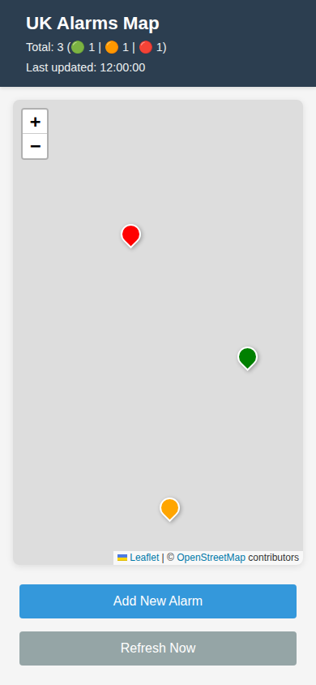

# Mark-QA

Playwright regression tests for the **UK Alarms Map** static application in [`src`](src).
The application displays alarms from an API on a Leaflet map.

## Running the tests

Prerequisite: Node.js 22 or newer with npm. From the repository root:

Windows / PowerShell:

```powershell
npm ci
npx playwright install chromium firefox webkit
npm test
```

Linux:

```sh
npm ci
npx playwright install --with-deps chromium firefox webkit
npm test
```

On Linux, `--with-deps` installs required system libraries and may need sudo.
Wait for each command to succeed before running the next. If `npm ci` fails,
Playwright is not installed and `npm test` cannot run; fix the installation
error first.
No application build step is required. There is no existing linter or build task.

Playwright automatically starts **live-server** at `http://127.0.0.1:8080`,
serving only `src`, and stops it afterwards. Leave port 8080 free; an existing
server is deliberately not reused so tests cannot target the wrong application.

```sh
npm test -- --project=chromium                 # Quick single-browser run
npm test -- --project=chromium --grep "deletion"
npm run test:headed -- --project=chromium      # Watch browser interactions
npm run test:report                           # Open the last HTML report
```

The default suite runs in Chromium, Firefox, and WebKit, including a narrow-screen
flow in each engine. Failures save screenshots and traces under `test-results`;
the HTML report is in `playwright-report`. Both directories are ignored by Git.
Open a retained trace with `npx playwright show-trace <path-to-trace.zip>`.
CI can use the same install and test commands; `CI` enables one retry and rejects
accidental `test.only` calls. Review retried failures rather than treating flakiness
as acceptable.

### Isolation and limitations

- Every test gets fresh in-memory alarm fixtures. All requests to the Azure API
  are intercepted, including POST and DELETE: **tests never modify real alarms**.
- The actual Leaflet 1.9.4 JavaScript and CSS are served from the pinned npm
  development dependency at their original CDN URLs, retaining integrity checks.
  Other external requests, including OpenStreetMap tiles, are blocked.
- Tests run without external network access after dependencies and browsers are
  installed. Map markers, popups, and zoom use real Leaflet, not a map stub.
  Blank grey map backgrounds in screenshots are intentional.
- Time is fixed for repeatable evidence; polling is tested by advancing
  Playwright's clock through 60 seconds, not sleeping for a minute.
- This suite protects frontend behavior and request contracts. It does **not**
  verify the live API, CDN availability, real map tiles, or visual pixel equality.
  Screenshots below are review evidence, not visual snapshot baselines.
- `package.json` overrides legacy `live-server` dependencies with patched
  Chokidar, http-auth, and UUID releases. The server is for unauthenticated,
  localhost-only testing; its legacy `--htpasswd` option is not supported by
  the overridden authentication API. Do not use it as a production server.

For a manual check with real external services, run `npm start` and open
`http://127.0.0.1:8080`. Unlike automated tests, this uses the **real API**:
adding or deleting an alarm changes remote data. Only do so with permission in
an appropriate test environment. Stop the server before running Playwright.

## User flows and regression coverage

The executable flows are in [`tests/alarms.spec.js`](tests/alarms.spec.js);
[`tests/fixtures.js`](tests/fixtures.js) contains the isolated API and CDN routing.

| Flow | User steps | Expected behavior / automated checks |
| --- | --- | --- |
| Load and explore | Open the application; select a marker; zoom in and out. | Title, total and per-status counts, update time, green/amber/red markers, popup name/status/description/six-decimal coordinates, and functional zoom controls. |
| Add an alarm | Select **Add New Alarm**, enter name and UK coordinates, optionally enter description, choose status, then **Add Alarm**. | Defaults are latitude 54.5, longitude -3.5, and green. Exact POST payload checked for every status; success alert, modal closure, new marker/counts/details, and form reset checked. |
| Validate input | Try a missing name, missing coordinates, or coordinates outside latitude 49–61 / longitude -8–2. | Browser validation blocks submission without an API write. Both inclusive coordinate boundaries and an empty description are accepted. |
| Dismiss dialogs | Open add or delete dialog; use **Cancel**, **×**, or the backdrop. | Dialog closes; no POST/DELETE occurs; markers remain. All three dismissal routes are tested for both dialogs. |
| Delete an alarm | Open a marker popup, select **Delete**, check the selected name, confirm **Delete**. | Correct ID in DELETE request; success alert; dialog closes; only selected alarm removed; counts refreshed. |
| Refresh manually | Select **Refresh Now** after fixture data changes. | Existing marker moves and popup details change, removed markers disappear, new markers appear, counts and last-update time refresh. |
| Refresh automatically | Leave application open for 60 seconds. | No early request; polling fetches new data at 60 seconds. Empty results clear all markers and show zero counts. |
| Recover from errors | Encounter a failed load, refresh, add, or delete; retry. | Specific failure alert; existing map/time preserved; failed add retains entered data; failed delete remains open; retry succeeds. Initial-load failure also recovers using **Refresh Now**. |
| Use a narrow screen | Open at 390 × 844; use the stacked controls and add an alarm. | No horizontal page overflow, visible heading, vertically stacked controls, usable form and successful add. This is viewport coverage, not real-device emulation. |

All tests also fail on unexpected uncaught browser JavaScript errors.
Expected API-error console messages are not treated as uncaught exceptions.

## Flow screenshots

Captured from passing Chromium tests using synthetic data and a fixed clock.

### 1. View alarms



### 2. Inspect an alarm



### 3. Add an alarm



### 4. Confirm deletion



### 5. Narrow-screen controls



To regenerate the checked-in screenshots from the same tested flows:

```sh
# Bash
UPDATE_DOC_SCREENSHOTS=1 npm test -- --project=chromium
```

```powershell
# PowerShell
$env:UPDATE_DOC_SCREENSHOTS = "1"
npm test -- --project=chromium
Remove-Item Env:UPDATE_DOC_SCREENSHOTS
```

Normal runs do not overwrite documentation images. Review regenerated images
before committing; browser/font/platform updates may change their appearance.

## Reviewer checklist

- [ ] Install with `npm ci`; run `npm audit` and review dependency/override changes.
- [ ] Run `npm test` successfully across all three browsers; investigate retries.
- [ ] Confirm new/changed user behavior has focused assertions in the flow table and tests.
- [ ] Check tests assert visible outcomes and request payloads, not merely successful clicks.
- [ ] Verify API writes remain intercepted and no test contacts real services.
- [ ] Exercise relevant success, validation, cancellation, empty-data, and failure/retry cases.
- [ ] Review the narrow-screen flow and screenshots; regenerate evidence when UI flows change.
- [ ] Inspect failure screenshots/traces where applicable; do not commit generated reports or dependencies.
- [ ] If integration behavior changed, perform an authorized manual check against a suitable API environment; never delete real alarms casually.
